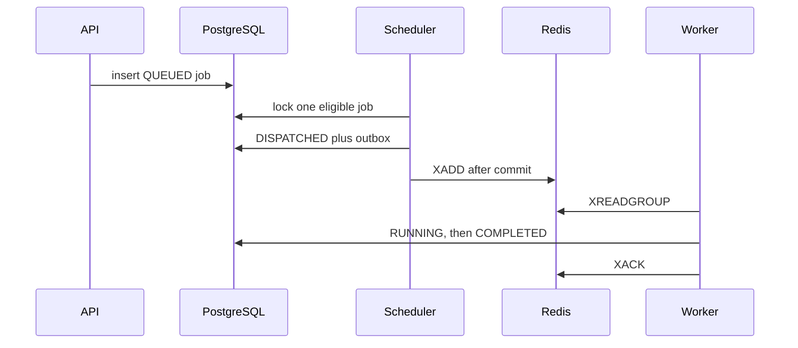

# Architecture

PostgreSQL is the source of truth for tenants, jobs, attempts, workers, events, scheduler fairness, benchmarks, and scaling events. The scheduler is the only process that reserves a job. It writes an outbox row in the same transaction, then publishes that row to the Redis stream `queuepilot:dispatch`. Workers in the consumer group `queuepilot-workers` execute one whitelisted task and acknowledge the stream entry only after the database commit.

The scheduler does not copy the pending backlog into Redis. One stream entry is one reserved attempt.

## Processes

| Process | Role |
|---|---|
| API | Authentication, jobs, metrics, admin settings, benchmark trigger |
| Scheduler | Retries, lease recovery, stale workers, policy selection, outbox publish |
| Worker | Heartbeats, task execution, cooperative cancel, drain on shutdown |
| Autoscaler | Host script. Spawns or drains Python workers. No Docker socket |
| PostgreSQL | Source of truth, on this machine at `127.0.0.1:5432` |
| Redis | Dispatch transport at `127.0.0.1:6379` |

## Job states

`QUEUED → DISPATCHED → RUNNING → COMPLETED`

A failed attempt moves to `RETRY_WAIT` and then back to `QUEUED`, or to terminal `FAILED` when `attempt_count` reaches `max_attempts`. `CANCELLED` is terminal. Cancellation of a running job sets a flag the task checks between steps.

Expired leases follow the same retry rule. A redelivered stream message is acknowledged without writing a result when the job’s current attempt id does not match, so a stale worker cannot overwrite a newer attempt.

## Scheduling

`fifo` takes the oldest eligible job. `priority` takes the highest priority, then the oldest. `wrr` and `wdrr` walk tenants by weight. Cursor, credits, and deficits live in `scheduler_state` row 1. A policy or weight change clears them.

Dispatch slots are the sum of healthy worker capacity minus jobs already `DISPATCHED` or `RUNNING`. A worker is healthy when its heartbeat is newer than 15 seconds.

## Data

`tenants`, `users`, `jobs`, `job_attempts`, `workers`, `job_events`, `outbox_events`, `benchmark_runs`, `scaling_events`, `scheduler_state`.

Demo tenants A, B, and C use weights 1, 2, and 3.
